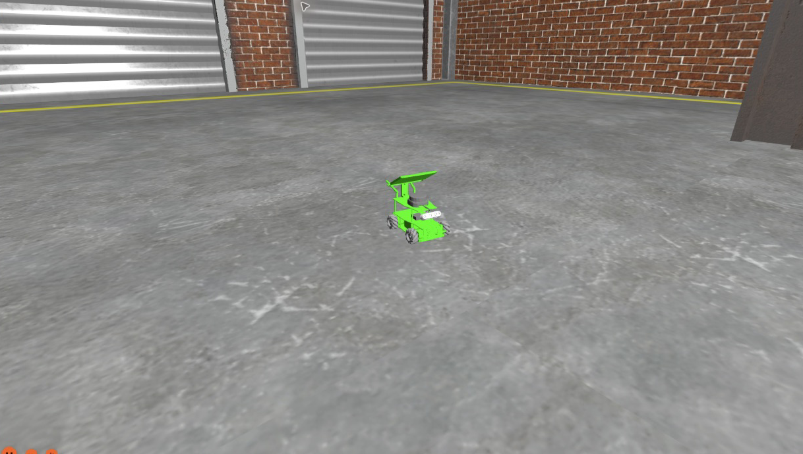

# ROSMASTER X3 + Gazebo Jetty

ROS 2 Lyrical에서 메카넘 로봇 ROSMASTER X3와 Nav2를 실행하는 패키지입니다. 창고 환경은 Gazebo Fuel의 Depot을 사용합니다.



## 실행 환경

- Ubuntu 26.04 / ROS 2 Lyrical
- Gazebo Jetty / Nav2 1.5.2
- ROS 환경과 `~/ros2_ws`가 설정된 터미널

## 설치

```bash
cd ~/ros2_ws/src
git clone https://github.com/robby-404canfind/rosmaster_x3_jetty.git
cd ~/ros2_ws
rosdep install --from-paths src/rosmaster_x3_jetty --ignore-src -r -y
colcon build --symlink-install --packages-select rosmaster_x3_jetty
source install/setup.bash
```

마지막 명령은 빌드한 터미널에서 환경을 갱신할 때 사용합니다. 워크스페이스가 `.bashrc`에 등록되어 있다면 새 터미널에서는 다시 입력하지 않아도 됩니다. Depot 모델은 처음 실행할 때 Gazebo Fuel에서 가져옵니다.

## 시뮬레이션과 Nav2 실행

```bash
# 터미널 1
ros2 launch rosmaster_x3_jetty bringup.launch.py
```

```bash
# 터미널 2
ros2 launch rosmaster_x3_jetty navigation.launch.py
```

RViz에서 `Navigation: active`를 확인하고 목표를 지정하면 됩니다. 기본 위치는 저장 지도에서 `(0, 0)`입니다. Gazebo 월드의 초기 위치 `(-8, 0)`과 구분해서 사용합니다.

## 금지 구역과 속도 제한

필터 예제를 바꿀 때는 아래 종료 순서로 Nav2와 시뮬레이터를 종료합니다. 터미널 1의 `bringup.launch.py`를 다시 실행하고, 터미널 2에서 필요한 설정으로 실행합니다. Nav2를 여러 개 동시에 실행하지 않습니다.

```bash
# 금지 구역
ros2 launch rosmaster_x3_jetty navigation.launch.py use_keepout_zones:=true
```

```bash
# 속도 제한 구역
ros2 launch rosmaster_x3_jetty navigation.launch.py use_speed_zones:=true
```

예제 마스크는 지도 좌표 `x=1~2`, `y=-0.6~0.6` 구간입니다. Keepout은 진입을 막고, Speed는 최대 속도를 50%로 제한합니다. 다른 마스크는 `keepout_mask:=경로` 또는 `speed_mask:=경로`로 지정할 수 있습니다.

## 종료

시뮬레이터가 켜진 상태에서 새 터미널에 입력합니다.

```bash
ros2 run rosmaster_x3_jetty shutdown_navigation
```

성공 응답을 확인한 뒤 Nav2 터미널에서 `Ctrl+C`, 마지막으로 시뮬레이터 터미널에서 `Ctrl+C`를 누릅니다. Nav2의 lifecycle을 먼저 종료하면 구성요소 정리 순서가 겹치는 문제를 피할 수 있습니다.

## 구성

- 바퀴 기반 Gazebo MecanumDrive와 바퀴 오도메트리
- 2D LiDAR, RGB-D 카메라, IMU
- Omni AMCL / Omni MPPI / 옆 방향 속도 평활화
- 기본 Nav2, Keepout·Speed Filter, 예제 BT
- 시뮬레이션용 구성. 실제 로봇의 하드웨어 드라이버는 포함하지 않습니다.

Lyrical의 `goThroughPoses()`에는 `nav_msgs/msg/Goals`를 전달하고, `goals` 배열에는 `PoseStamped`를 넣습니다.

검증 범위와 한계는 [VALIDATION.md](VALIDATION.md), 모델·코드 출처는 [THIRD_PARTY.md](THIRD_PARTY.md)를 참고하세요.
